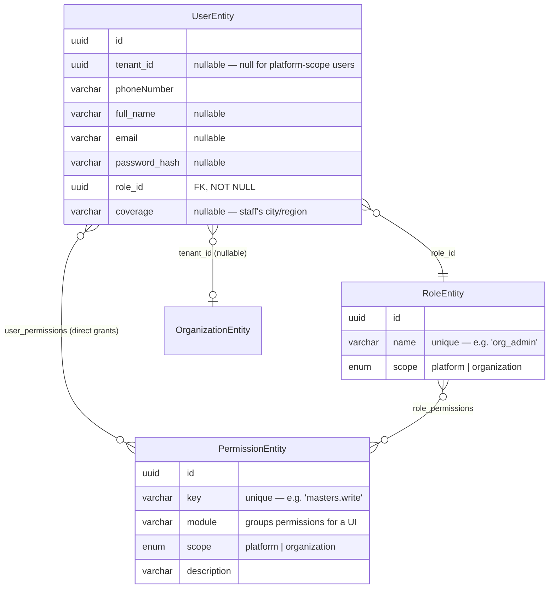

# Auth, Roles & Permissions — Technical Reference

This document covers how identity, roles, and permissions work in this codebase: the data model,
the request-time authorization flow, the full role/permission catalog, the API surface for
managing them, how bootstrapping works, and known gaps. It reflects the current implementation —
not a design proposal.

## 1. Mental model

- **Permissions** are individual, developer-defined actions (`kyc.online.verify`,
  `masters.write`, …). Fixed catalog — only ever added via a migration/seed change, never through
  the app.
- **Roles** are fixed, seeded *bundles* of permissions (`platform_admin`, `sales`, `org_admin`, …).
  Also fixed — nobody, including `platform_admin`, can create a new role through the API.
- **A user's real authority** = their role's permissions **∪** any permissions granted to them
  individually (`user_permissions`). This is where flexibility lives — not from inventing more
  roles, but from handing a specific user an extra permission on top of their role.
- **`platform_admin` manages platform-scope things** (internal staff, cross-tenant org admin).
  **`org_admin` manages organization-scope things, only within their own org.** Every
  assignment/grant action is checked against this split — see [§5](#5-the-authorization-rule-assertcanmanage).

## 2. Data model



All four tables live in the `auth` Postgres schema. Schema management is via TypeORM migrations
([db/migrations/](../src/db/migrations/)), auto-applied on every deploy
(`.github/workflows/deploy.yml`) — `synchronize` ([data-source.ts](../src/db/data-source.ts)) is
off on real servers (`!['staging', 'production'].includes(env.nodeEnv)`), on everywhere else.
See [§9](#9-known-gaps--deliberate-trade-offs).

| Entity | File | Notes |
|---|---|---|
| `RoleEntity` | [modules/roles/entities/role.entity.ts](../src/modules/roles/entities/role.entity.ts) | No `tenantId` — roles aren't per-org, only per-scope |
| `PermissionEntity` | [modules/roles/entities/permission.entity.ts](../src/modules/roles/entities/permission.entity.ts) | `module` is UI-grouping metadata, not enforced anywhere |
| `UserPermissionEntity` | [modules/roles/entities/user-permission.entity.ts](../src/modules/roles/entities/user-permission.entity.ts) | `grantedBy` is a plain uuid column (audit trail only, no FK) |
| `UserEntity` | [modules/auth/entities/user.entity.ts](../src/modules/auth/entities/user.entity.ts) | `roleId` is `NOT NULL` — every user always has exactly one role |

**Module ownership split**, worth knowing before you go looking for a file:

- **`modules/roles/`** owns the whole RBAC domain end to end — entities, repository, service
  (`getEffectivePermissions`, `assertCanManage`, `assignRole`, `grantPermission`,
  `revokePermission`), and its own API layer (controller/routes/validators/openapi), mounted at
  `/v1/roles`.
- **`modules/auth/`** owns identity/sessions only (signup, login, JWT issuance) and imports
  `RoleService` from `modules/roles/` — a one-directional dependency, same pattern
  `modules/admin/` already uses for reading `modules/organization/`'s `OrganizationService`. No
  gateway interface; direct constructor injection, wired in
  [composition-root.ts](../src/composition-root.ts).
- **`modules/organization/`** owns the organization/organization-document/referral-code domain —
  entities, repositories, services, and the org onboarding state machine
  (`OrganizationOnboardingService`). It also serves the onboarding HTTP endpoints
  (`GET/POST /v1/auth/organization*`, in `organization.controller.ts`/`organization.routes.ts`),
  mounted at the same `/v1/auth` path as `modules/auth/`'s own protected router (two routers
  sharing one mount prefix — see [app.ts](../src/app.ts)) — those URLs predate this module
  existing and were kept unchanged when the code moved out of `modules/auth/`. The controller
  delegates the actual orchestration (which also mutates the caller's session — tenantId + token
  pair on first-time org creation) to `AuthService`, the same "read another module's service
  directly, no gateway" pattern as everywhere else in this list.
- **`modules/admin/`** is a thin, `platform_admin`-only, cross-tenant wrapper — organizations
  and staff management, both by calling into `auth`'s/`roles`'s/`organization`'s services, no
  domain logic of its own.

## 3. The role catalog

Defined in [db/role-catalog.ts](../src/db/role-catalog.ts) (`PERMISSIONS` and `ROLES`, pure
data) and seeded by [db/seed-roles.ts](../src/db/seed-roles.ts) (`npm run seed:roles`). Nothing
else ever inserts a row into `auth.roles`. **`role-catalog.ts` is the authoritative list.** The
table below shows a few roles for orientation and is not exhaustive. The org teammate roles
(`sales_cs`, `dispatch`, `documents_ops`, `finance_accounts`) and the Loadsmart ops roles
(`ls_*`, `load_console`) are all there.

| Role | Scope | Who gets it | Permissions |
|---|---|---|---|
| `platform_admin` | platform | Bootstrapped once ([§8](#8-bootstrapping)); never self-service | **None seeded** — superuser bypass is code-level, see [§4](#4-the-permission-catalog) |
| `sales` | platform | Created via `POST /v1/admin/staff` | `sales.leads.manage` |
| `online_kyc_desk` | platform | Created via `POST /v1/admin/staff` | `kyc.online.verify`, `kyc.online.reject` |
| `offline_kyc_desk` | platform | Created via `POST /v1/admin/staff` | `kyc.offline.verify`, `kyc.offline.reject` |
| `load_console` | platform | Created via `POST /v1/admin/staff` | `loads.console.access` |
| `org_admin` | organization | Self-signup only (`POST /v1/auth/verify-otp`) — or promoted by an existing `org_admin` in the same org via `PATCH /v1/roles/users/:id/role` | `organization.profile.manage`, `masters.write` |

**Adding a new role** = add a row to `role-catalog.ts`'s `ROLES` array + re-run
`npm run seed:roles`. There is no `POST /v1/roles` endpoint and there won't be one without a
deliberate design change — see [§10](#10-how-to--common-changes).

## 4. The permission catalog

Seeded the same way, same file. Permissions are **per-action**, not read/write pairs per
resource — `kyc.online.verify` and `kyc.online.reject` are two independent permissions a user
could have one of without the other.

| Key | Module | Scope | Description |
|---|---|---|---|
| `admin.organizations.manage` | admin | platform | Manage organizations across all tenants |
| `organization.profile.manage` | auth | organization | Create/update the caller's own organization profile |
| `masters.write` | masters | organization | Create/update/delete vehicles, drivers, and their documents |
| `kyc.online.verify` | onboarding | platform | Verify KYC submitted online |
| `kyc.online.reject` | onboarding | platform | Reject KYC submitted online |
| `kyc.offline.verify` | onboarding | platform | Verify KYC submitted offline |
| `kyc.offline.reject` | onboarding | platform | Reject KYC submitted offline |
| `loads.console.access` | dispatch | platform | Access the load console |
| `sales.leads.manage` | sales | platform | Manage sales leads |

Named constants for these live in
[shared/constants/permissions.ts](../src/shared/constants/permissions.ts) — route guards import
the constant, never the raw string. **`masters.write` is intentionally coarse**: one permission
covers both vehicle and driver writes; nothing has needed a finer split yet. There is no generic
"read" permission — reads are open to any authenticated org member by default
([masters.routes.ts](../src/modules/masters/masters.routes.ts)); permissions only ever gate
writes/actions.

`platform_admin` has **zero** rows in `role_permissions`. It doesn't need any — see next section.

## 5. Runtime authorization

### JWT shape

```json
{ "id": "...", "tenantId": null, "role": "online_kyc_desk", "permissions": ["kyc.online.verify", "kyc.online.reject"], "jti": "...", "purpose": "access", "exp": 1234567890 }
```

`purpose: "access"` marks this as a real access token — `authMiddleware` rejects any bearer token
without it, closing a gap where a signup-purpose token (self-obtainable, unauthenticated, via
`POST /v1/auth/signup`) could otherwise be replayed against a protected route.

`permissions` is computed **fresh at every token issuance** (signup, login, refresh, org-creation
re-issue) via `RoleService.getEffectivePermissions(userId)` — role's permissions ∪ direct grants,
deduped. It is never recomputed mid-request; a request only ever consults the array already
decoded off the bearer token.

**Staleness trade-off**: if an admin changes what a role or user can do, it takes effect on that
user's *next* login/refresh, not instantly — bounded by the access-token TTL
(`env.accessTokenTtlSeconds`, default 15 min). Same trade-off this system already had for `role`
before permissions existed; no new mechanism was built to force it sooner.

**Frontend guidance**: for anything authorization-sensitive — deciding whether to show a module,
nav item, or action button — don't trust the JWT's `permissions` claim (or the login/refresh
response's `permissions` field) as the live source of truth; treat it as a coarse snapshot good
enough for initial routing only. Call `GET /v1/roles/users/:userId/permissions` (§7) instead when
the answer needs to be current — it always reflects the real, up-to-the-second effective set
(role ∪ direct grants), with no staleness window. This is a frontend-side convention, not
something this backend enforces or can enforce without the token-invalidation work described in
§9.

### `requirePermission` — the route guard

[shared/middleware/require-permission.middleware.ts](../src/shared/middleware/require-permission.middleware.ts):

```ts
export function hasPermission(user: PermissionHolder | undefined | null, key: string): boolean {
  if (!user) return false;
  return user.role === PLATFORM_ADMIN_ROLE || user.permissions.includes(key); // superuser bypass
}

export const requirePermission = (...permissions: string[]): RequestHandler => (req, _res, next) => {
  if (!permissions.some((p) => hasPermission(req.user, p))) {
    throw new AuthorizationError('Insufficient permissions');
  }
  next();
};
```

`hasPermission` is the single permission check. Services use it too, when a decision depends on
what the caller can do. For example, "the creator could approve this, so it skips the approval
queue" is `hasPermission(actor, MASTERS_APPROVE)` (`CUSTOMERS_APPROVE` for customers). Services
that need this take a `PermissionHolder` (`Pick<AuthenticatedUser, 'role' | 'permissions'>`),
not a bare role name.

#### Rule: never gate a feature on a role name

The role catalog (`db/role-catalog.ts`, seeded by `db/seed-roles.ts`) is the single source of truth for what a role can do. Access
decisions and capability switches must read permissions, either `requirePermission` on the route
or `hasPermission` in the service. Never write `role === ORG_ADMIN_ROLE` for these. A role-name
check behind a route gate creates a second, invisible rule: the route lets a caller in, the service
throws, and direct grants through `user_permissions` silently stop working.

Role names are still the right tool for:
- **Governance of RBAC itself**: `assertCanManage` / `assertCanView` (§6), and org-teammate
  invite/manage in `auth.service.ts`.
- **Identity checks on a target user**: "is this assignee an online KYC desk?", "is this
  referral-code owner a sales person?", "find the org's owner".
- **Scope**: `PLATFORM_SCOPE_ROLES` in tenant-scope and storage (platform user vs tenant user).
- **Notification audiences**: `recipientRoles` in the notification catalog.

#### Reads: gate by the keys that act on the data

Most tenant reads are open to every member of the tenant (vehicle and driver lists, loads,
masters lists), because pickers across the app need them. Sensitive reads are gated by the keys
of the people who act on that data, any-of:

| Data | Gate |
|---|---|
| Load payments, Loadsmart invoice, shipper-analytics freight-spend and billing | `payments.manage` |
| Loadsmart charges and claims | `payments.manage` or `dispatch_planning.manage` |
| Requisition list, detail and available vehicles | `requisitions.manage` or `dispatch_planning.manage` |
| Masters CSV exports (drivers, vehicles, transporters, contracts, products, loading points) | `masters.write` |
| Driver documents, verifications, trip metrics; vehicle documents, verifications, telemetry | `masters.write` |
| Driver bank details (read and verify) | `payments.manage` |

Sensitive **fields** inside an open response are redacted with `hasPermission` instead. The
pattern is the same as `maintenance/utils/cost-visibility.ts`:
- Transporter bank account fields are returned only with `payments.manage` (`toTransporterView`).
- Driver detail drops `bankDetails` without `payments.manage`, and drops `documents` and
  `verifications` without `masters.write` (`DriverService.getDriver`).
- Vehicle detail drops `documents`, `verificationSnapshots` and `telemetryMeta` without
  `masters.write` (`VehicleService.getVehicleWithTyres`).
- Raw IDfy bank-verification payloads (`bankRawResponse`, `rawResponse`) are never returned.
- Transporter `freightOwed` (and sorting by it) is returned only with `payments.manage`, the
  same rule as the bank account (`canSeeTransporterMoney`).
- Driver pay (`salaryType`, `salaryAmount`, `bhattaPerDay`, `advanceOutstanding`, and the detail
  `contact.compensation`) is returned only with `payments.manage` or `masters.write`
  (`driverPayForViewer`): on the roster, driver detail and join-request lists. Where a driver is
  embedded in another screen (vehicle detail `driverLinks`, load detail) pay is always stripped
  (`withoutDriverPay`), and so is the transporter's bank data (`withoutTransporterBank`). The
  analytics cost calculations still read pay on the server. Don't hide these columns with TypeORM
  `select: false`, or the driver costs those calculations produce become 0.
- The shipper analytics Overview stays open but drops every rupee figure without
  `payments.manage` (`withoutOverviewMoney`). It sets `meta.moneyHidden: true` so the frontend
  shows "hidden" rather than 0.

`src/modules/read-access-gates.test.ts` checks each gated read against every org role's bundle,
read straight from `db/role-catalog.ts`, so a seed change is reflected automatically.

`platform_admin`'s bypass is **code-level, not data-level** — its `role_permissions` stays empty
on purpose, so adding a new permission never requires remembering to also grant it to
`platform_admin`.

Applied per-route, e.g. [masters.routes.ts](../src/modules/masters/masters.routes.ts):
`const canWrite = requirePermission(MASTERS_WRITE);`

### `createTenantScope` — the other gate

[shared/middleware/tenant-scope.middleware.ts](../src/shared/middleware/tenant-scope.middleware.ts)
requires `req.user.tenantId` to be set (and matching any `X-Tenant-Id` header) — **except** for
`PLATFORM_SCOPE_ROLES` ([shared/constants/roles.ts](../src/shared/constants/roles.ts):
`platform_admin` + `STAFF_ASSIGNABLE_ROLES`), which are exempted entirely, since none of them are
ever tied to a tenant (`tenantId` is always `null` for every platform-scope user). Every route
this middleware guards is otherwise unreachable for those roles. For everyone else it also calls
`tenancyGateway.assertTenantActive(tenantId)`, which checks the organization's `status` against an
allow-list (`TENANT_ACCESSIBLE_STATUSES` in
[modules/organization/organization.constants.ts](../src/modules/organization/organization.constants.ts)) —
`rejected`/`suspended` orgs are genuinely locked out of every tenant-scoped route, not just
conceptually.

**The `PLATFORM_SCOPE_ROLES` bypass above is global** — it applies to every router in tier 3
below, not just the ones that need it. That's correct for `/v1/roles` and `/v1/admin`, which
platform-scope users legitimately use, but a router representing tenant-owned resource data only
(e.g. `/v1/masters`) has no legitimate platform-scope caller at all. `masters.routes.ts` closes that
gap itself with an additional, router-specific `requireTenant` guard
([shared/middleware/require-tenant.middleware.ts](../src/shared/middleware/require-tenant.middleware.ts))
applied at the top of the router — any platform-scope role now gets a clean 403 instead of an
empty result set on reads or a DB `NOT NULL` constraint error on writes. The same file also
exports `requireTenantId(req)`, a small helper controllers use in place of a raw
`req.user!.tenantId!` non-null assertion, since `AuthenticatedUser.tenantId` is honestly typed as
`string | null` (see [request.types.ts](../src/shared/middleware/request.types.ts)) and only
routes sitting behind `requireTenant` can safely treat it as guaranteed.

### Route protection tiers

Set up in [composition-root.ts](../src/composition-root.ts) / [app.ts](../src/app.ts):

1. **`publicRouters`** — no auth (`/v1/auth/signup`, `/v1/auth/verify-otp`, `/v1/auth/login`,
   `/v1/auth/refresh`).
2. **`authenticatedRouters`** — authenticated, tenant optional: `modules/auth/`'s own `logout`,
   `deleteAccount`, plus `modules/organization/`'s `GET/POST /v1/auth/organization*` (a second
   router sharing the same `/v1/auth` mount — see [§2](#2-data-model)) — a user mid-signup has no
   org yet, so this whole tier can't require one.
3. **`routers`**: authenticated and behind `createTenantScope`, which org users must pass (their
   `tenantId`, plus an active org for writes). Platform-scope roles skip it, so **every entry
   declares its scope**, and the `MountedRouter` type enforces that:
   - `scope: 'tenant'`: `app.ts` mounts it behind `requireTenant`, so a platform-scope caller gets
     a clean 403. This is the **default for every new router**. It covers `/masters`, `/loads`,
     `/customers`, `/maintenance`, `/geofences`, `/notifications` (and its QA `/test` route),
     `/dashboards`, all analytics, and the `/tracking` and `/payments` stubs.
   - `scope: 'crossTenant'` plus a written `reason`: platform staff legitimately use it, so it must
     enforce its own scope:
     - `/roles`: the `assertCanManage`/`assertCanView` checks in `role.service.ts`.
     - `/admin`: a platform permission on every route.
     - `/loadsmart-ops`: an `ls_*` permission on every route.
     - `/files`: described below.
   Routers also keep their own `router.use(requireTenant)` as defence in depth.
   `src/app.tenant-routers.test.ts` checks the mount-level guard.

**Staff reading other tenants' files** (`StorageService.get`/`getByKey`, the tenant-less branch,
`staffMayRead`):

| Caller | May read |
|---|---|
| `platform_admin` | any file |
| KYC review permissions (`kyc.online.*`, `kyc.offline.*`) | `kyc`, `organizations/shopboard-premises`, `profile` |
| `loads.console.access` or any `loadsmart.*` team key | every `loads/*` and `trips/*` purpose |
| any other staff (e.g. `sales`) | only files it uploaded itself |

The map is `STAFF_CROSS_TENANT_READS` in `modules/storage/storage.constants.ts`. Anything else
answers 404, the same as a missing file. Callers must pass `userId` and `permissions` in the
`FileAccessActor`.

### Driver profiles across fleets

A driver is **one global profile** (`masters.drivers`) shared by every fleet they're linked to.
Documents, bank accounts and verifications hang off it by `driverId`, and their `tenantId` records
only which fleet added the row. Each fleet's link (`driver_tenant_relations`) decides its
standing (`DriverService`):

| Standing | Link | Allows |
|---|---|---|
| `assertDriverVisible` | anything but `rejected`/`cancelled` | the invite lifecycle (approve, reject, cancel or remove its own link) |
| `assertDriverReadable` | `active`, or a pending request **the driver started** | full detail, documents, verifications, bank accounts, operational status, trip metrics |
| `assertDriverEditable` | `active` only | every write to the profile and its rows |

- **Pending links the fleet started.** An invite the driver hasn't accepted, or a declined or
  cancelled link, only shows who was asked: `toLimitedPendingDriver` returns `id`, `fullName`,
  `phoneNumber`, link status, `initiatedBy`, `requestedAt` and `limited: true`. That applies to
  `GET /drivers/:id`, the roster and the join-request lists.
- **Onboarding a phone that already has a profile** creates only the pending link. It never
  attaches documents, bank details or a verification to the existing profile, and it answers with
  the limited view plus `profileReused: true`.
- **Verified identity is locked.** Once `licenseVerified` is true, fleets get a 409
  (`DRIVER_IDENTITY_VERIFIED`) when they try to change `fullName`, licence number, expiry or
  endorsements, `dateOfBirth` or the address. Only the driver app (whose licence upload re-runs
  Sarathi on the server) or a real re-verification can change them. A staff-recorded verification
  on a verified profile is stored as history but doesn't rewrite the licence fields.
- **Adder-only rows.** Only the fleet that added a document or bank account may delete it or
  change its verification (403 `NOT_ADDED_BY_THIS_FLEET`). The driver's own uploads
  (`tenantId` null) can't be changed by any fleet.
- **Known limitations:**
  - Employment terms (salary, bhatta, advance, date of joining, engagement type) are still global
    on the profile, so two active fleets overwrite each other's values.
  - `POST /drivers/:id/verifications` trusts a client-supplied `verified` status for an
    unverified profile.
  - `POST /drivers/verify-dl` returns the stored profile of any driver whose licence number is
    typed in.

## 6. The authorization rule: `assertCanManage`

The single rule every role-assignment / permission-grant / permission-revoke goes through
([role.service.ts](../src/modules/roles/role.service.ts)):

```ts
assertCanManage(actingUser, targetUser, thingScope: 'platform' | 'organization') {
  if (actingUser.id === targetUser.id) throw AuthorizationError;   // no self-service escalation
  if (isPlatformAdministrator(actingUser)) {       // platform_admin, or a holder of the admin key
    if (thingScope !== 'platform') throw AuthorizationError;
    if (targetUser.tenantId !== null || targetUser.role.scope !== 'platform')
      throw AuthorizationError;                      // staff only, never an org user
    if (targetUser.role.name === PLATFORM_ADMIN_ROLE)
      throw AuthorizationError;                      // platform_admins: seed script only
    return;
  }
  if (actingUser.role === ORG_ADMIN_ROLE) {
    if (thingScope !== 'organization') throw AuthorizationError;
    if (targetUser.tenantId !== actingUser.tenantId) throw AuthorizationError;
    return;
  }
  throw AuthorizationError;   // no other role may manage roles/permissions at all
}
```

The self-target check means nobody — including `platform_admin` — manages their own role or
permissions through `assignRole`/`grantPermission`/`revokePermission`; an `org_admin` can't hand
themselves an extra organization-scope permission this way even though the scope/tenant checks
below would otherwise let them.

Falls out of the rest of this rule, not special-cased: an `org_admin` **can** promote a teammate in
their own org to `org_admin` (scope matches, tenant matches, and it's not a self-target) — that's
how a second org admin gets created after the first self-signup. `platform_admin` can **never**
grant `org_admin` through this path — its scope isn't `platform` — so org-admin provisioning stays
exclusively the self-signup flow.

**`grantPermission` adds one more check on top, `assertTargetScopeMatches`**: the permission being
granted must match the *target user's own* role scope, not just the actor's authority over that
scope. Without it, a `platform_admin` could grant a platform-scope permission (e.g.
`admin.organizations.manage`) to an `org_admin` — `assertCanManage` alone only confirms the actor
may hand out platform-scope permissions at all, never that this particular recipient should hold
one, which would give that org_admin de facto cross-tenant platform-admin capability via the
permission claim on their next token. It's applied only to `grantPermission`, not to `assignRole` or `revokePermission`.
`assignRole` is covered by `assertCanManage`'s target checks. It also refuses any platform role
outside `STAFF_ASSIGNABLE_ROLES`, so `platform_admin` is never assignable through the API.
`revokePermission` (left open, so a mismatched grant made before this check existed can still be
cleaned up through the API instead of needing direct DB access).

### Platform administrators

- **`isPlatformAdministrator(user)`** (`require-permission.middleware.ts`) is true for the
  `platform_admin` role **or** anyone holding `admin.organizations.manage`. The key is
  grantable, and every admin-authority decision uses this check: `assertCanManage`,
  `assertCanView`, the role catalog, `AdminService`'s org scoping, and the staff list. Checks about
  a *target's* identity (is the target a platform_admin, a KYC desk or sales) stay role-based.
- **`platform_admin` accounts come only from `seed:platform-admin`.** No API path assigns,
  edits, demotes or deletes one: `/roles` refuses (above), `/admin/staff` covers only
  `STAFF_ASSIGNABLE_ROLES` targets, and `updateStaff` loads its target with `findStaffUserById`,
  so it can never repoint an org user's or an admin's phone or email.
- **Staff creation checks its direct grants first** (`RoleService.assertPlatformPermissionIds`),
  so a bad or organization-scope permission ID can't leave a half-created account.
- **KYC review scoping** (`AdminService.reviewerScopeFilter` / `assertOrgAccessible`):
  - platform administrators see every organization;
  - an offline desk sees its assignments once online KYC is done;
  - everyone else sees only organizations assigned to them. Only desk roles can be assigned, so a
    non-desk staff member granted a KYC key sees none. There is never an unscoped list.
- **`GET /admin/staff` for a KYC reviewer** returns `id`, `fullName`, `role`, `coverage` and
  `workload` only, without phone, email or referral data.

## 7. API surface

### `modules/roles/` — mounted at `/v1/roles`

| Method & path | Gate | Purpose |
|---|---|---|
| `GET /v1/roles` | contextual (`assertCanViewCatalog`) — `platform_admin` or `org_admin` only | List the fixed role catalog, optional `?scope=` filter |
| `GET /v1/roles/permissions` | contextual (`assertCanViewCatalog`) — `platform_admin` or `org_admin` only | List the fixed permission catalog, optional `?scope=` filter |
| `GET /v1/roles/users/:userId/permissions` | contextual | Effective (role ∪ direct) permissions for a user — self, or `platform_admin`, or same-org `org_admin` |
| `PATCH /v1/roles/users/:userId/role` | contextual (`assertCanManage`) | `{ roleId }` — replace a user's role |
| `POST /v1/roles/users/:userId/permissions` | contextual (`assertCanManage`) | `{ permissionId }` — grant one extra permission |
| `DELETE /v1/roles/users/:userId/permissions/:permissionId` | contextual (`assertCanManage`) | Revoke a direct grant (role's own permissions unaffected) |

None of these carry a flat `requirePermission(...)` gate — authorization is contextual
(`assertCanViewCatalog`/`assertCanManage`/`assertCanView`), which a static permission list can't
express. The two catalog-listing endpoints used to be open to any authenticated user; role names
and permission keys/descriptions aren't customer data, but they do reveal internal authorization
structure an ordinary staff account (`sales`/KYC desk/`load_console`) has no reason to see.

### `modules/admin/` — mounted at `/v1/admin`, blanket `requirePermission(ADMIN_ORGANIZATIONS_MANAGE)`

| Method & path | Purpose |
|---|---|
| `GET/PATCH /v1/admin/organizations[...]` | Cross-tenant org management |
| `POST /v1/admin/staff` | Provision an internal staff account — see [§7.1](#71-post-v1adminstaff-in-detail) |
| `GET /v1/admin/staff` | List staff (paginated, searchable) |

#### 7.1 `POST /v1/admin/staff` in detail

```json
{
  "fullName": "Priya Sharma",
  "phoneNumber": "9123456780",
  "email": "priya.kyc@company.com",
  "roleId": "<uuid, must resolve to sales/online_kyc_desk/offline_kyc_desk/load_console>",
  "coverage": "Mumbai",
  "permissionIds": ["<optional, extra permission ids beyond the role>"]
}
```

- `roleId` is checked against `STAFF_ASSIGNABLE_ROLES`
  ([shared/constants/roles.ts](../src/shared/constants/roles.ts)) — `platform_admin`/`org_admin`
  explicitly rejected (400).
- Phone and email are both pre-checked for collisions (409) — self-signup can rely on OTP proving
  phone ownership; this path can't, so both are checked.
- The password is **not** admin-supplied — `AuthService.generatePassword()` generates one
  server-side and hashes it the same way as every other password in this codebase (bcrypt, cost
  10). See [§9](#9-known-gaps--deliberate-trade-offs) for the gap this currently leaves open.
- The account authenticates via the **existing** `POST /v1/auth/login` (email + password) — this
  endpoint never issues a token, since the admin isn't the one logging in.
- `permissionIds` grants are **not transactional** with account creation — reuses
  `RoleService.grantPermission` in a loop, so the account is still created even if one id in the
  list is bad; the error names which id failed, and it can be retried alone via
  `POST /v1/roles/users/:id/permissions`.
- Response's `permissions` field is the account's full effective list (role ∪ granted), computed
  via `getEffectivePermissions`, not hand-assembled from the request.
- Every create/grant is audit-logged (`STAFF_CREATED`, `PERMISSION_GRANTED`) with real
  before/after data in `audit.audit_logs`.

## 8. Bootstrapping

**Auto-run on every deploy** (`.github/workflows/deploy.yml`, after `migration:run` and before
`pm2 restart`), in this order:

1. **[db/seed-roles.ts](../src/db/seed-roles.ts)** (`npm run seed:roles`) — seeds every
   permission, role and role↔permission bundle in `db/role-catalog.ts`. Idempotent (upserts by `key`/`name`,
   fully replaces each role's permission set on every run — safe to re-run after editing the
   catalog). Adding a new role/permission in code is now enough on its own — no manual SSH step.
2. **[db/seed-platform-admin.ts](../src/db/seed-platform-admin.ts)** (`npm run seed:platform-admin`)
   — creates the very first `platform_admin`. There's no other way to get one: self-signup only
   ever produces `org_admin`, and `POST /v1/admin/staff` itself requires an existing `platform_admin`
   to call it. Reads `BOOTSTRAP_ADMIN_PHONE`/`EMAIL`/`PASSWORD`/`NAME` from the environment (must
   already be set in that server's `.env`). Idempotent — a second run with the same phone/email
   just no-ops.
3. Every subsequent `platform_admin`-created account goes through `POST /v1/admin/staff` normally.

**`npm run seed:*`/`npm run migration:*` are still broken when invoked via their npm-script form**
— `ts-node@10.9.2` can't read `tsconfig.json` under the aliased `typescript` package
(`Cannot read properties of undefined (reading 'fileExists')`), a pre-existing version mismatch
unrelated to RBAC. The deploy workflow and the commands above sidestep this entirely by running
the **compiled** output directly (`npm run build` first, then e.g.
`node -r reflect-metadata dist/db/seed-roles.js` / `node ./node_modules/typeorm/cli.js
migration:run -d dist/db/data-source.js`) — no ts-node involved. Only a plain local `npm run
seed:roles`/`npm run migration:run` invocation is still affected.

### The permission-key startup guard

[modules/roles/assert-permissions-seeded.ts](../src/modules/roles/assert-permissions-seeded.ts),
called from [server.ts](../src/server.ts)'s `bootstrap()` right after the datasource initializes.
Every string exported from `shared/constants/permissions.ts` must exist in `auth.permissions`, or
the server refuses to start with an error naming exactly which key is missing. Without this, a
typo'd or forgotten-to-seed constant wouldn't error anywhere — the route it gates would just
silently 403 everyone forever, since no JWT could ever contain a key nobody granted.

## 9. Known gaps / deliberate trade-offs

Worth knowing before you assume something is a bug:

- **Migrations now exist** (`src/db/migrations/`), auto-applied on deploy via
  `.github/workflows/deploy.yml` (`migration:run` → `seed:roles` → `seed:platform-admin` →
  `pm2 restart`, in that order — the seeds depend on tables the migration creates, and
  `assertPermissionsSeeded` refuses to let the server boot until seeding finishes). `synchronize`
  is dev-only now. Going forward, schema changes are: edit the entity → run `migration:generate`
  locally against an up-to-date dev DB → review the SQL → commit the new migration file alongside
  the entity change — not "just restart and let synchronize handle it" anymore.
- **Org admins can't create custom roles.** The schema doesn't block it structurally, but there's
  no endpoint for it — this was explicitly deferred. New org-scope roles today are a developer
  seed-script addition, same mechanism as the platform-scope ones (see [§10](#10-how-to--common-changes)).
- **`masters.write` is one combined permission**, not split by vehicle/driver or read/write.
- **Permission-key drift is caught (§8's guard); role-name drift isn't.** The same risk exists for
  `STAFF_ASSIGNABLE_ROLES`/`PLATFORM_ADMIN_ROLE`/`ORG_ADMIN_ROLE` vs. `auth.roles`, just without an
  equivalent startup check yet.
- **Permission/role changes aren't instant** — bounded by access-token TTL (§5). Revoking a
  compromised account's access sooner requires killing their refresh-token family / blocking their
  current `jti`, not a permission change. There's no per-user active-`jti` tracking today (only
  refresh tokens are persisted per user), so even an on-demand "force this specific user to
  re-auth now" isn't wireable into `grantPermission`/`revokePermission`/`assignRole` without adding
  that bookkeeping first — see §5's frontend guidance for the workaround that needs no backend
  change (poll `GET /v1/roles/users/:userId/permissions` instead of trusting the JWT).
- **A freshly created staff account has no way to learn its own password.** `POST /v1/admin/staff`
  generates one server-side (§7.1) but never returns it in the response, and there's no
  notification module wired up yet to email/SMS it anywhere either.

## 10. How to / common changes

**Gate a new route with an existing permission**: import the constant from
`shared/constants/permissions.ts`, add `requirePermission(THE_CONSTANT)` to the route.

**Add a brand-new permission**:
1. Add the key to `db/role-catalog.ts`'s `PERMISSIONS` array (`key`, `module`, `scope`, `description`).
2. Add a matching named constant to `shared/constants/permissions.ts`.
3. Add it to whichever role(s) in `role-catalog.ts`'s `ROLES` array should have it.
4. `npm run build && node -r reflect-metadata dist/db/seed-roles.js` (or `npm run seed:roles` once
   the ts-node issue is fixed).
5. Use the constant in `requirePermission(...)` wherever it should gate a route, or in
   `hasPermission(actor, ...)` where a service branches on it. Don't add a `role ===` check
   instead (see §5's rule).

**Add a brand-new fixed role** (platform or organization scope): add it to `role-catalog.ts`'s
`ROLES` array with its starting permission bundle, re-seed. If it's a staff-assignable
platform-scope role, also add its name to `STAFF_ASSIGNABLE_ROLES`
(`shared/constants/roles.ts`) so `POST /v1/admin/staff` can hand it out.

**Give one specific user extra powers without a new role**: `POST /v1/roles/users/:id/permissions`
with `{ permissionId }` (or `permissionIds` at creation time via `POST /v1/admin/staff`).
